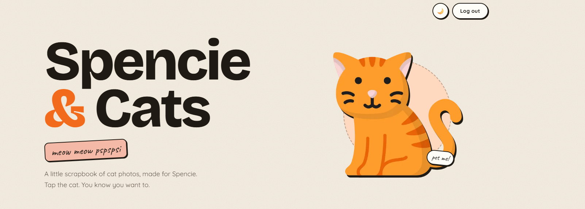

# Spencie & Cats

**Live site:** [spencercats.netlify.app](https://spencercats.netlify.app)



A cute little website I made for my partner, Spencer, to collect photos of every cat we meet. Visitors can scroll the gallery as a scrapbook of polaroids and pet the cat in the header. Only signed-in admins can add photos, edit captions or delete anything.

## Tech stack

- **Next.js 16** (App Router) with route handlers for the API
- **React 19** and **TypeScript** in strict mode
- **Tailwind CSS 4**, using a warm scrapbook-style theme with light and dark modes
- **Supabase** for auth, Postgres and image storage
- **sharp** for server-side image processing
- **Motion**, **Sonner** and **Yet Another React Lightbox** for animation, toasts and the photo viewer
- **Netlify** for hosting
- **pnpm** for packages

## Getting started

Copy `.env.example` to `.env` and fill in your Supabase project values:

| Variable | Used by | Value |
| --- | --- | --- |
| `SUPABASE_URL` | Server | Project URL |
| `SUPABASE_KEY` | Server | Secret (`sb_secret_…`) key |
| `NEXT_PUBLIC_SUPABASE_URL` | Browser | Project URL |
| `NEXT_PUBLIC_SUPABASE_ANON_KEY` | Browser | Publishable (`sb_publishable_…`) or legacy anon key |
| `ADMIN_EMAILS` | Server | Comma-separated emails allowed to change the gallery |

Then run:

```bash
pnpm install
pnpm dev
```

Then open [http://localhost:3000](http://localhost:3000).

To check and build:

```bash
pnpm typecheck
pnpm lint
pnpm build
```

## Project structure

```
app/
  page.tsx                 Home page
  login/page.tsx           Admin sign-in
  layout.tsx               Fonts, metadata, theme bootstrap and the toaster
  globals.css              Tailwind theme tokens (light and dark)
  api/
    cats/route.ts          GET a page of photos (cursor-based), POST an upload
    cats/[key]/route.ts    PATCH a caption, DELETE a photo
    me/route.ts            Whether the signed-in user is an admin
  components/
    cat-scrapbook.tsx      Page shell that wires the pieces together
    gallery.tsx            Masonry grid, loading and empty states
    polaroid.tsx           A single photo card
    cat-lightbox.tsx       Full-screen viewer with admin caption editing
    upload-dialog.tsx      Drag-and-drop upload
    modal.tsx              Shared dialog built on the native <dialog>
  hooks/                   Admin session, paginated feed, theme and meows
lib/
  supabase-server.ts       Service client and the requireAdmin check
  api-client.ts            Typed fetch helpers used by the UI
  prepare-image.ts         Resizes photos and strips metadata on the device
scripts/
  strip-metadata.mjs       Removes EXIF data from local images
  strip-existing-uploads.mjs  Removes EXIF data from photos already in storage
supabase/
  policies.sql             Row-level security and bucket settings
```

Captions, upload limits and page sizes live in `lib/storage.ts`.

## Deployment

The site deploys to Netlify, which runs the Next.js API routes as serverless functions. Set the same environment variables in the Netlify site settings, then run `supabase/policies.sql` once in the Supabase SQL editor. Turn off public sign-ups in Supabase (Authentication > Sign In / Providers), since admin accounts are created by hand.

## Security

It's a small site, but it's built like a real one:

- **Admin-only writes, checked on the server.** Every upload, edit and delete verifies the Supabase session server-side and requires an email on the `ADMIN_EMAILS` allowlist. Hiding buttons in the UI is not the protection.
- **No privileged keys in the browser.** The build fails if the browser key is a secret or `service_role` key.
- **Locked-down database.** Row-level security is on and browser keys have no table access. All reads and writes go through the API.
- **Safe uploads.** File size is capped, the real image format is checked with sharp, files get random names, and every photo is re-encoded. That removes EXIF data, including GPS location, before anything is stored.
- **Security headers.** These include a Content-Security-Policy, `frame-ancestors 'none'`, `nosniff`, a strict referrer policy and HSTS. Next's inline bootstrap needs `'unsafe-inline'` for scripts, because the site doesn't use a per-request nonce.
- **Careful dependencies.** Versions are pinned exactly. pnpm blocks releases less than a day old and only lets vetted packages run install scripts. `pnpm audit` is clean.
